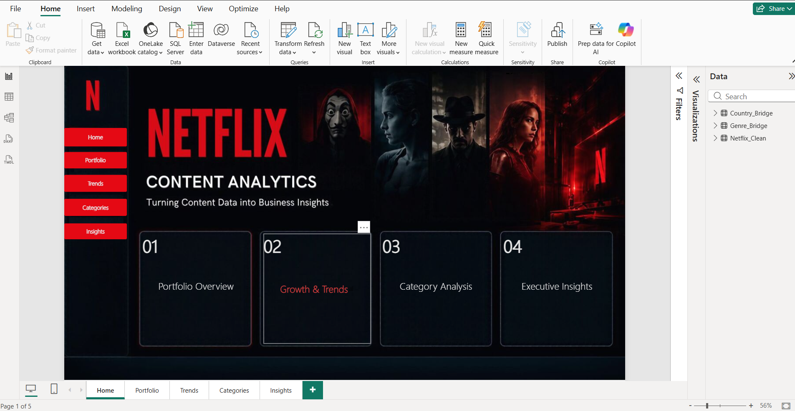
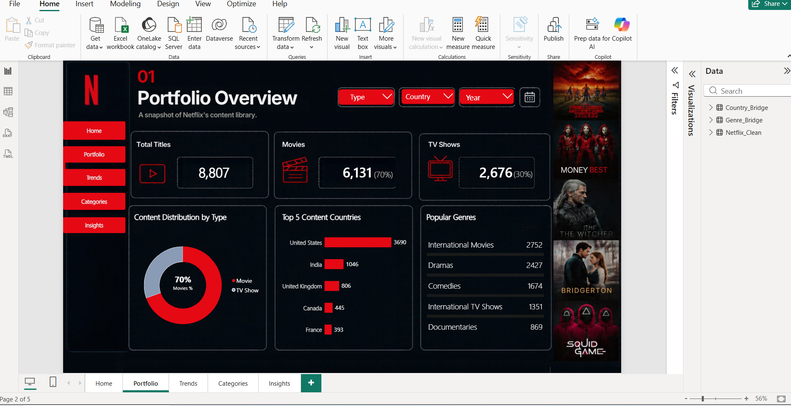
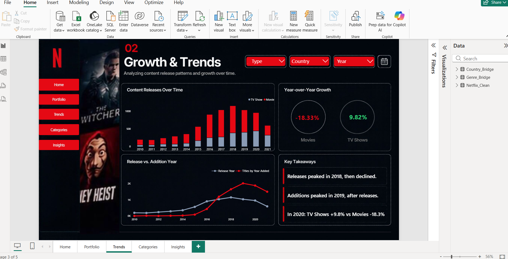
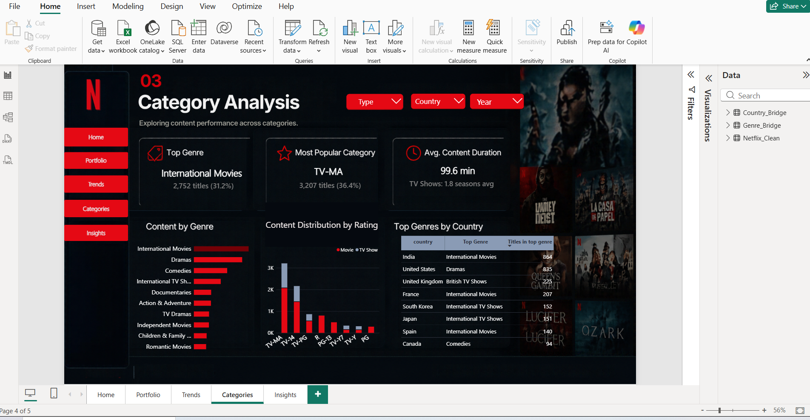
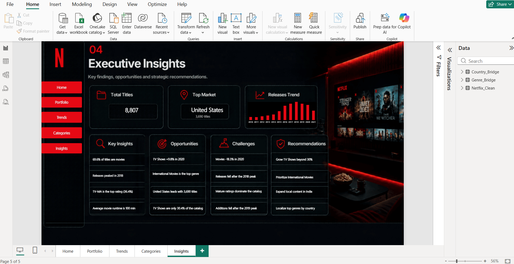

 # Netflix Content Analysis

A Power BI dashboard built for the Auspify Business Analytics internship.
It analyzes the Netflix titles dataset (8,807 titles) and covers Tasks 1, 4, 5 and 6.

## Files
- `NetflixProject.pbix`: the Power BI dashboard
- [Netflix Content Analysis.pdf](Netflix%20Content%20Analysis.pdf): short summary report

## Dashboard pages

### Home

### Portfolio (Task 1)
Movies vs TV shows, top countries and genres.

### Trends (Task 4)
Releases by year, year-over-year growth, release vs addition year.

### Categories (Task 5)
Top genre, most common rating, average duration.

### Insights (Task 6)
KPIs, opportunities, challenges and recommendations.

## Notes
- "Category" means audience rating (for example TV-MA).
- Country and genre counts include titles with more than one value, so they overlap.
- The data has no viewing numbers, so "top" means most titles.

Data source: Netflix Titles dataset (Kaggle).
